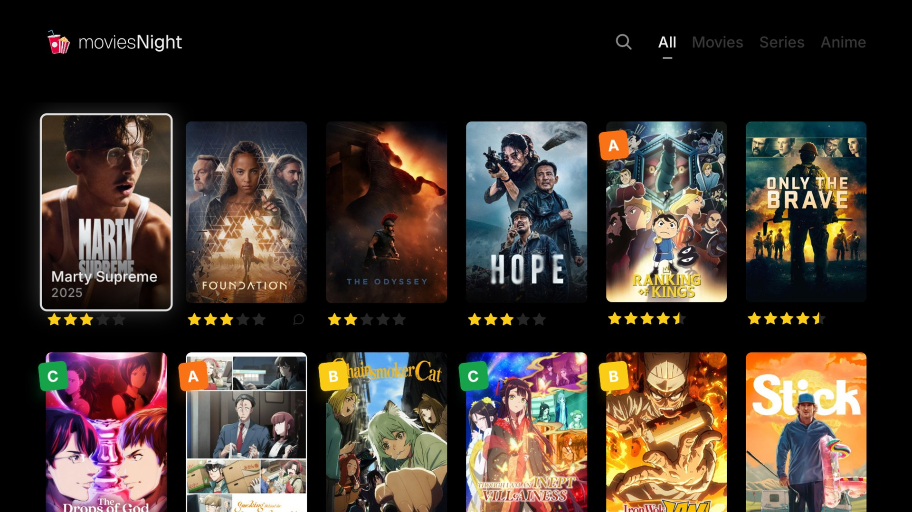

# moviesNight for Android TV

A private, read-only Android TV app for my NVIDIA Shield Pro (2019). It shows the movies, series and
anime I've watched and how I rated them, read directly from the Supabase database behind my website
([movies.juliuszlioba.com](https://movies.juliuszlioba.com), repo `moviesnight-nextjs-supabase`).

It's for personal use only. It's sideloaded with adb and will never go to a store. It needs no login,
because it only reads what the database already exposes publicly through RLS.



**What it does (v1.0.0)**

- Home: logo on the left, category tabs on the right (**All · Movies · Series · Anime**) and, below
  them, the category's view tabs: **Recent · Top** for Movies and Series, **Recent · Top · Tiers** for
  Anime (All has only Recent, so no second row). Each category remembers its last view. Recent is a
  6-column poster grid sorted by watched date, newest first; pages load as you scroll. Anime appear
  only under All and Anime, not under Movies or Series.
- The header floats over the grid on a translucent black gradient, so posters slide faintly under it
  as you scroll. The view tabs hide once you scroll past the first row and come back at the top or
  when focus moves into the header. The background is pure black (`#000000`) for the OLED TV.
- Top (Movies / Series / Anime): only records on that top list, in list order
  (`sort_order_movie` / `sort_order_series` / `sort_order_anime`, lowest first), as on the website's
  sorted pages.
- Anime › Tiers: every anime grouped by tier (S → F, then ungraded "?"), each tier in anime-list
  order, as on the website's `/anime/tier`. Each tier's posters wrap to the right of a solid strip in
  the tier's colour. Its tile shows the letter, "TIER", a thin rule and the count, and sticks just
  below the header while you scroll through a long tier.
- Each card shows the poster, the stars (rating 1–10 shown as 5 stars with halves) and the S–F tier
  sticker, if set. A yellow thumbs-up sticker below the tier sticker marks records in the movie or
  series top list ("Highly recommended", as on the website; hidden in Movies › Top and Series › Top, where
  every record has it), and a small speech bubble after the stars marks records
  with a review. The focused card scales up and shows its title and year.
- OK opens the detail screen: a large poster, title, year/type, stars, watched date, genres, the
  "Highly recommended to see!" line, the recommendation (yellow quote, as on the website) and the
  review. Up/Down scroll long reviews.
- Search (magnifier left of the tabs) finds records by title as you type.
- Back returns to the same poster in the grid. Back from inside the grid (or from the view tabs) jumps
  to the top and the category tabs; Back on the category tabs exits.

---

## Stack

| | |
|---|---|
| Language / UI | Kotlin, Jetpack Compose for TV (`androidx.tv:tv-material`) |
| Data | [supabase-kt](https://github.com/supabase-community/supabase-kt) (Postgrest) + Ktor OkHttp |
| Paging / images | Paging 3, Coil 3 (TMDB poster CDN) |
| Navigation | Navigation Compose, type-safe routes |
| Build | Gradle 9.9 (wrapper), AGP 9.5 with built-in Kotlin 2.4, version catalog in `gradle/libs.versions.toml` |
| Device | minSdk 28, target/compile 37. The Shield runs Android 11 (API 30). |

There's no DI framework: `MoviesNightApp` holds the repository and the Coil image loader.

---

## First-time setup (new PC or fresh clone)

1. Install **Android Studio**. It brings the SDK and a JDK (`<Android Studio>/jbr`).
2. Copy `local.properties.example` to `local.properties` and fill it in:
   - `supabase.url` / `supabase.key`: from `.env` (production, `NEXT_PUBLIC_SUPABASE_URL` /
     `NEXT_PUBLIC_SUPABASE_PUBLISHABLE_KEY`)
   - `supabase.local.url`: `http://<this PC's LAN IP>:54321` (`ipconfig` → IPv4)
   - `supabase.local.key`: from `.env.local`

   The build also reads `TMDB_API_KEY` (TMDB API v3 key) straight from `.env` for the detail
   screen's description. Without it the app still builds; the description is just left out.

   `local.properties`, `.env` and `.env.local` are git-ignored. The publishable key is a public,
   read-only key, but keep it out of git anyway.
3. Open the folder in Android Studio and let Gradle sync. Or use the command line: in a plain terminal,
   point Gradle at Android Studio's JDK first:
   ```powershell
   $env:JAVA_HOME = "C:\Program Files\Android\Android Studio\jbr"
   ```

---

## Build types: which database each one uses

| Build | Database | Use it for | Command |
|---|---|---|---|
| **release** | **production** Supabase (HTTPS) | what lives on the Shield day to day; works with the PC off | `.\gradlew installRelease` |
| debug | local Docker Supabase (HTTP over LAN) | development in Android Studio / emulator | `.\gradlew installDebug` |
| profile | local Docker Supabase | release-speed build for judging smoothness | `.\gradlew installProfile` |

- All three share the app id `com.moviesnight.tv`, so installing one replaces the other on the device.
- Plain HTTP is only allowed in debug/profile (`app/src/debug/res/xml/network_security_config.xml`).
  Release is HTTPS-only.
- **Don't judge smoothness from the debug build.** Compose is much slower unoptimised. Measured on the
  Shield: about 51% janky frames in debug vs about 14% in profile/release.
- Release is signed with the **debug keystore** (`%USERPROFILE%\.android\debug.keystore`). That's fine
  for sideloading. If that file is lost or the PC changes, the next install fails with a signature
  mismatch. Fix: `adb uninstall com.moviesnight.tv`, then install again (the app keeps no user data).
  Back the keystore up if you want to avoid that.

---

## Developing without the Shield

- **Compose previews**: open a screen or component file in Android Studio and switch to *Split* or
  *Design*. Previews use made-up records from `ui/preview/SampleRecords.kt`, and posters are drawn
  as color gradients because previews can't download images. Screens render at the Shield's size
  (960×540 dp). Use *Interactive mode* to move focus with the arrow keys.
- **TV emulator**: the `NVIDIA_Shield_Androit_TV_-_Virtual` AVD (Android 11 / API 30, 1080p) behaves
  like the Shield. Run the debug build on it with Docker Supabase running. Arrow keys and Enter work
  as the D-pad and OK, and Esc works as Back.
- Judge smoothness on the real Shield with the profile build, not in previews or the emulator.

---

## Deploying to the Shield

One-time setup on the Shield: Settings → Device Preferences → About → click **Build** 7×, then
Developer options → **Network debugging** on.

```powershell
adb connect 192.168.1.176:5555        # Shield's IP; accept the prompt on the TV the first time
$env:JAVA_HOME = "C:\Program Files\Android\Android Studio\jbr"
.\gradlew installRelease
```

Optional: make it fully compiled right away instead of waiting for Android to do it in the background:
`adb shell cmd package compile -f -m speed-profile com.moviesnight.tv`

If the Shield's or PC's IP changes (DHCP), update `adb connect` / `supabase.local.url`. A DHCP
reservation in the router avoids this.

---

## Local Supabase (Docker), for debug/profile builds

`supabase-dev-server/` holds the Supabase CLI project used to run a local copy of the database:

- `supabase/migrations/`: schema, copied from the website repo. **Keep these in sync with the
  website when the schema changes.**
- `supabase/seed.sql`: a dump of the public tables (records, genres) to fill the local DB.

```powershell
cd supabase-dev-server
pnpm install
pnpm exec supabase start      # API on :54321 (Docker Desktop must be running)
pnpm exec supabase db reset   # re-apply migrations + seed
```

For the **Shield** to reach Docker on this PC, Windows Firewall needs an inbound rule. Run once in an
admin PowerShell:
```powershell
New-NetFirewallRule -DisplayName "Supabase local (LAN)" -Direction Inbound -Protocol TCP -LocalPort 54321 -RemoteAddress LocalSubnet -Profile Private -Action Allow
```
The emulator doesn't need this, because its traffic starts on the PC itself.

---

## Data model notes (things that aren't obvious)

The app only reads. Everything goes through `data/RecordsRepository.kt`.

- **Table `records`**: `mediatype` is only ever `movie` or `series`.
- **Anime has no media type.** Like the website, a record is anime when `sort_order_anime IS NOT NULL`.
  The Movies and Series tabs filter on `mediatype` **and** `sort_order_anime IS NULL`, so anime show up
  only under All and the Anime views (Recent, Top, Tiers). An anime missing `sort_order_anime` still lands in
  Movies/Series.
- **Rating** is an integer 1–10 (0/null = unrated), shown as 5 stars with halves (9 → ★★★★½). The
  mapping is in `data/model/Rating.kt` and matches the website's `StarRating`.
- **Tier** (`S/A/B/C/D/F` or null) uses the same Tailwind colours as the website's `lib/tiers.ts`:
  S red-500, A orange-500, B yellow-400 (dark text), C green-600, D blue-500, F purple-600.
- **Genres** live in `ganres` (sic) via the join table `records_ganres`. PostgREST can't embed `ganres`
  directly (the join table has its own `id`), so the query goes through it:
  `records_ganres(ganres(title))`. Newer records often have no genres. The `ganres` table also has a
  "Series" entry (id 1).
- **Posters** are TMDB paths (`/abc.jpg`), loaded from `image.tmdb.org/t/p/w342` (grid) and `w780`
  (detail). `data/remote/Tmdb.kt`.
- **Description** on the detail screen is TMDB's `overview` from `/3/movie/{tmdbid}` or
  `/3/tv/{tmdbid}` (v3, `api_key` query param). It's fetched with the record (3 s cap) so the text
  doesn't jump in later; if TMDB is slow or fails, the screen shows without it.
- **Tier list** (`animeTierList()`): all anime ordered by `sort_order_anime`, fetched in chunks of
  1000 (PostgREST `max_rows`), then grouped by tier in `data/model/TierList.kt`. Same query as the
  website's `fetchAllAnimeTierRecords`.
- **Sorting** is by `watchedat desc, id desc`. The `id` tiebreaker keeps page boundaries stable.
  Paging is offset-based, 42 rows per page (7 full grid rows).
- **Top lists**: `sort_order_movie`, `sort_order_series` and `sort_order_anime` are a record's place in
  that list, or null if it isn't on it. The Top views filter on `IS NOT NULL` and sort by the column
  ascending (then `id`); the column is `MediaFilter.topListColumn`. A place in the movie or series
  list (not the anime one) is what makes a record "highly recommended".
- **Columns** are listed in `data/remote/RecordDto.kt` (`SUMMARY_COLUMNS` for the grid,
  `DETAIL_COLUMNS` for the detail screen). Add new fields there and in the DTO/model.

---

## Code map

```
app/src/main/java/com/moviesnight/tv/
├─ MainActivity.kt, MoviesNightApp.kt   entry point; app singletons + Coil loader
├─ data/
│  ├─ RecordsRepository.kt              Supabase queries + Pager
│  ├─ RecordsPagingSource.kt            offset paging
│  ├─ Supabase.kt                       anonymous client from BuildConfig
│  ├─ model/                            MediaFilter (grid queries), Rating, RecordSummary/RecordDetail,
│  │                                    TierList (grouping by tier)
│  └─ remote/                           DTOs + column lists, TMDB image URLs
└─ ui/
   ├─ AppNavigation.kt                  Home → Detail(id)
   ├─ home/                             HomeScreen (header, tabs, grid, focus), HomeViewModel,
   │                                    HomeCategory (category → views), AnimeTierList
   ├─ detail/                           DetailScreen (poster, info, scrolling), DetailViewModel
   ├─ components/                       PosterCard, StarRating, TierBadge, Quote, Logo,
   │                                    GridScroll (custom row scrolling), Focus helpers
   └─ theme/                            colours, Inter (UI) + Geist (wordmark) fonts
```

### TV-specific behaviour worth knowing before changing things

- **Focus on launch / return**: `HomeScreen` remembers the last focused poster (`focusedId`) and each
  tab's scroll position (saveable `LazyGridState`s). It refocuses that poster when coming back from
  the detail screen. `requestFocusWhenReady()` retries for a few frames, because lazy items attach
  after the first layout.
- **Tabs** come in two rows, both switching on focus (TV convention): categories, then the
  category's views (`HomeCategory`, each view one `MediaFilter`). The view row keeps its height even
  when empty (All), so the grid doesn't jump while moving across categories. `focusRestorer` on each
  TabRow makes Up/Down land on the current tab, not the nearest one.
- **The header is an overlay.** The grid and tier list fill the whole screen behind it and get
  `topInset` as extra top content padding. The inset is the category row's measured height plus the
  view row, even while the view row is hidden, so hiding it never shifts the grid. Because the
  content's bounds now start at the top of the screen, geometric focus search can't cross the header
  by itself: Down from the header's bottom row requests the content's `contentFocus` (then
  `focusRestorer` picks the last poster), and Up out of the content goes to the current view tab, or
  the category tab when there's no view row, instead of the nearest header item.
- **Grid scrolling is custom** (`ui/components/GridScroll.kt`). The built-in "bring focused item into
  view" animation jumps hard at the start and creeps at the end, and since Compose 1.8 its animation
  can't be customised. So it's disabled (`NoAutoScroll`), and each focus change calls
  `scrollRowToPivot()`: one 300 ms ease-in-out glide that rests the focused row 140dp below the grid
  top. Don't remove one half without the other. The tier list is a `LazyColumn` of poster rows and
  uses the same approach (`scrollItemToPivot()`).
- **Tier list labels** are an overlay beside the list, not list items. Their position and the solid
  colour strips are computed from `LazyListState.layoutInfo` in the layout/draw phase, so scrolling doesn't
  recompose them.
- **Focus zoom is draw-only.** `PosterCard` scales in `drawWithContent`, not `graphicsLayer`/Card's own
  scale. Scaling the layer changes the bounds that scrolling measures and made the page wobble
  on every Left/Right. The tier sticker has `zIndex(2f)` because the TV Card raises itself when focused.
- **Detail screen**: the text column is the only focus target. It handles Up/Down itself to scroll.
  The poster fills the screen height, so its top/left/bottom margins are equal (`Margin` = 48dp).

---

## Tests

```powershell
.\gradlew testDebugUnitTest          # unit tests (rating mapping, JSON decoding, paging, tier grouping)
.\gradlew testDebugUnitTest -Plive   # + smoke tests against the local Docker DB (read-only)
```

---

## Assets: logo, app icon, launcher banner

Source: the website's `public/img/svg/movieNight_logo.svg`. The SVG uses CSS classes and blend modes
that Android vector drawables can't express, so it's rendered to PNGs with headless Edge:

| File | Size | What |
|---|---|---|
| `res/drawable-nodpi/logo.png` | 256×256 | header logo |
| `res/mipmap-xxxhdpi/ic_launcher_foreground.png` | 432×432, logo 300px centred | adaptive icon foreground (background = `#000000`) |
| `res/drawable-xhdpi/banner.png` | 640×360 | TV launcher banner: logo + "movies**Night**" in Geist |

To regenerate: write a small HTML page with the `` (and for the banner, the Geist
`@font-face` from the website's `node_modules/geist/dist/fonts/geist-sans/Geist-Variable.ttf`), then:
```powershell
& "C:\Program Files (x86)\Microsoft\Edge\Application\msedge.exe" --headless=new --disable-gpu `
  --hide-scrollbars --force-device-scale-factor=1 --default-background-color=00000000 `
  --window-size=640,360 --screenshot=C:\path\banner.png file:///C:/path/banner.html
```
Fonts: `res/font/inter.ttf` (UI) and `res/font/geist.ttf` (wordmark). Both are variable fonts, OFL.

---

## Troubleshooting

| Symptom | Cause / fix |
|---|---|
| "Couldn't load your list" in debug/emulator | Local Supabase not running, or `supabase.local.url` uses `127.0.0.1`. It must be the PC's LAN IP. |
| Works in emulator, not on the Shield (debug) | Firewall rule missing (see above), or the Shield still has an older build installed. |
| Launcher still shows the old icon/name | Projectivy caches artwork. `adb shell am force-stop com.spocky.projengmenu` |
| `adb` screenshots are black | The Shield is asleep or showing the screensaver. `adb shell input keyevent WAKEUP` |
| Install fails with a signature mismatch | Different debug keystore. `adb uninstall com.moviesnight.tv`, then reinstall. |
| Grid feels janky | You're on the debug build. Use `installProfile`/`installRelease` to judge. |

---

## Ideas for later

- Hide the "Series" pseudo-genre on the detail screen.
- Yellow quote mark on reviews too (the website uses it for both).
- Sort by rating.
- Refresh when returning to the app, so new records from the website appear without restarting.
